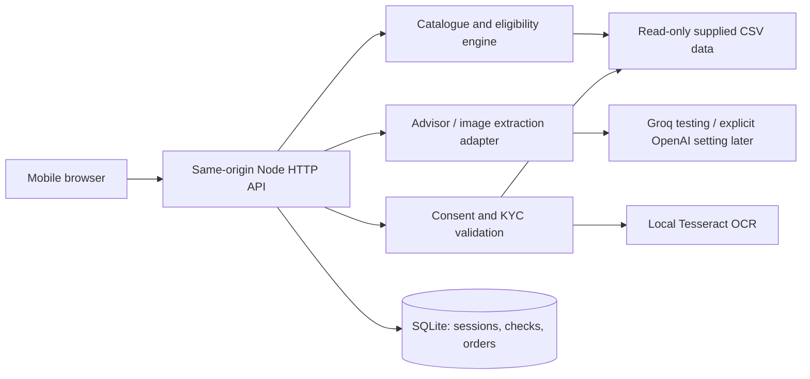

# Application architecture

## Decision
Use a browser frontend with HTML/CSS/JavaScript and a Node.js 24 backend. Use Node's built-in SQLite for local persistence and built-in HTTP/fetch/test modules. Tesseract.js with an installed English model supplies local OCR. This keeps installation small and preserves the existing visual prototype. A framework can be introduced when complexity warrants it.

## Boundaries
- `src/catalogue.mjs`: CSV parsing, normalized profile, eligibility, dependency validation, quantity pricing and recommendation policy.
- `src/ai.mjs`: bounded, structured AI calls; no credentials or government ID data in advisor context. The server, not the model, owns price/eligibility.
- `src/kyc.mjs`: registry lookup, GST checksum, document-field checks and fixed-date validation.
- `src/store.mjs`: prepared SQL, session ownership and saved quote/check snapshots.
- `server.mjs`: route validation, request limits, cookie sessions, same-origin protection and explicit static allowlist.
- `app.js`: screens, safe rendering and asynchronous API orchestration.

## Request flow
Normalize business profile -> calculate eligible bundle -> optionally ask AI to phrase a response -> reprice edits on server -> obtain KYC consent -> extract documents if enabled -> validate registry and fields -> save order with quote/check snapshot -> read by session and ID.

## Failure design
AI failure retains deterministic recommendations and reports guided mode. Extraction failure yields review-required. Missing documents do not stop saving a review order; they do block a ready-for-installation status. Physical activation has no automatic success transition.

## Production work
Before public use: verified customer authentication, HTTPS, managed encryption/key rotation, rate limits across instances, background document processing, object storage/malware scanning, monitored migrations/backups, legal review and real provisioning adapters. Local prototype runs on loopback by default.

## Added modules
- `src/ocr.mjs`: bounded local workers and conservative extraction from supplied English forms, without raw-text persistence.
- `src/guided.mjs`: explicit English/Hindi no-key conversational rules, never labelled live AI.
- `src/analytics.mjs`: aggregate funnel/segment evidence for `npm run analyze`.

Recommendations search eligible combinations to cover more requested needs before choosing higher internet tiers. Email/security quantities initially cover the full team; SIM quantities remain an explicit editable starter assumption.

## Testing provider
`src/ai-config.mjs` selects the explicitly configured provider. Groq is the testing default; OpenAI remains an optional later evaluation. The reply guard checks currency amounts against quote/context values, normalizes INR formatting and rejects unknown monetary values. Checkout still owns all authoritative prices.
