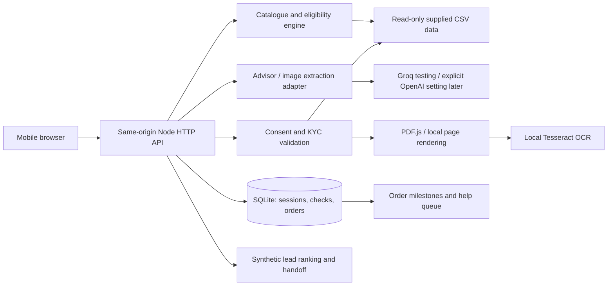

# Application architecture

Mandatory customer auth: setup, advisor, KYC and order APIs return 401 without verified Clerk identity. The frontend starts with the customer shell hidden and mounts Clerk sign-in before initializing the journey. Missing/unavailable Clerk fails closed. Legacy rule/OCR tests can explicitly create an in-memory fixture with `requireCustomerAuth:false`; this is not a browser or environment-controlled bypass.

Customer auth update: official `@clerk/backend` verifies Clerk session JWTs against the configured issuer and exact request origin (`authorizedParties`). A hash of verified issuer/user ID supplies the existing SQLite/PostgreSQL owner key; no email/name lookup grants ownership. Browser SDK scripts load from the configured Clerk instance with scoped CSP allowances. Explicit same-origin guest linking moves only cookie-owned records, transactionally within each database and retry-safe across them. Account owners have seven-day inactivity retention; KYC cleanup independently enforces an absolute seven-day case lifetime. Staff access tokens remain separate. See `customer-auth.js`, `src/customer-auth.mjs` and the authentication tests.

Current Smart KYC design: `kyc-reader.mjs` isolates file errors, reads PDF text or uses local raster/OCR; `kyc.mjs` applies deterministic supplied-registry, name/address/date and cross-document checks. `kyc-store.mjs` retains owner-scoped originals, necessary fields, contexts, results and review comments as AES-GCM ciphertext. Minimal verification/order snapshots omit full review fields. The separately authorized `kyc-review.html/js` workflow records simulated decisions and cannot approve deterministic errors. This supersedes earlier transient-only KYC descriptions. See `smart-kyc.md` for setup, migration, retention and measured specimen results.

## Decision

The package page offers a separate consented preliminary GST lookup when a requested service requires active registration. `POST /api/registration-check` checks format/checksum, active status and legal/trade-name agreement against the supplied mock registry, then reruns the existing recommendation rules. It enforces customer authentication and canonical journey ownership/revision. Responses mask the identifier, and the lookup writes neither raw identifiers into conversation memory nor a KYC verification record. Within the current page session, consented identifiers remain checkout inputs for recommendation/repricing; requirement changes or switching chats clear them. Document processing still requires its separate KYC consent and certificate checks. A browser reload requires re-entry until a saved KYC case supplies evidence.
Current demo pricing: `quote()` derives `checkoutMonthly` from the sum of catalogue minimums and returns `pricingPolicy=catalogue_minimum_demo_v1`. Quote and tracker show that single labelled demo amount with the unchanged min–max reference range. Orders reprice on the backend and store this policy in the immutable snapshot. This is a disclosed prototype policy, not an actual provider tariff confirmation.

Quotation lines also expose backend-derived `selectionType` values (`requested`, `supporting`, `addon`) based on confirmed service needs and catalogue dependencies. `breakdown` holds monthly and setup subtotals for each group. The package page groups these lines, shows their fixed demo monthly amount and reference range, and itemizes setup fees. Client-supplied classification and amounts cannot control these calculations. Newly created orders persist the repriced grouping alongside their existing quote snapshot; historical snapshots remain readable.

Use a browser frontend with HTML/CSS/JavaScript and a Node.js 24 backend. Use Node's built-in SQLite for existing browser sessions, KYC and orders; use PostgreSQL for independent advisor conversation histories and memory. Use built-in HTTP/fetch/test modules. Tesseract.js with an installed English model supplies local OCR. PDF.js and a local canvas renderer convert PDF pages to images before OCR. A separate synthetic-data sales desk supports explainable lead review and handoff.

## Boundaries
- `src/catalogue.mjs`: CSV parsing, normalized profile, eligibility, dependency validation, quantity pricing and recommendation policy.
- `src/ai.mjs`: bounded, structured AI calls; no credentials or government ID data in advisor context. The server, not the model, owns price/eligibility.
- `src/kyc.mjs` and `src/pdf.mjs`: image/PDF validation, local rendering/OCR, registry lookup, GST checksum, masked field review and fixed-date validation.
- `src/analytics.mjs`: aggregate dataset analysis and rules-ranked lead follow-up queue; dashboard output omits contact names and registration IDs.
- `src/store.mjs`: prepared SQL, session ownership and saved quote/check snapshots.
- `server.mjs`: route validation, request limits, cookie sessions, same-origin protection and explicit static allowlist.
- `public/app.js`: screens, safe rendering and asynchronous API orchestration.

## Request flow
Normalize business profile -> calculate eligible bundle and catalogue price range -> let advisor explain from catalogue context -> reprice edits on server -> obtain KYC consent -> locally render/extract documents -> show masked fields for customer review -> validate registry and fields -> save order with quote/check snapshot -> read by session and ID. Separate synthetic lead and help queues are served without contact/registration identifiers.

## Failure design
AI failure shows a clear retry notice and does not present a generated fallback answer. The structured package flow remains available. Extraction failure yields review-required. OCR fields are returned transiently for explicit review; extracted values are stripped before verification persistence. Tracker demo controls append simulated installation/activation events and do not contact an operator.

## Production work
Before public use: verified customer authentication, HTTPS, managed encryption/key rotation, rate limits across instances, background document processing, object storage/malware scanning, monitored migrations/backups, legal review and real provisioning adapters. Local prototype runs on loopback by default.

## Added modules
- `src/ocr.mjs`: bounded local workers and conservative extraction from supplied English forms, without raw-text persistence.
- `src/guided.mjs`: explicit English/Hindi no-key conversational rules, never labelled live AI.
- `src/analytics.mjs`: aggregate funnel/segment evidence for `npm run analyze`.

Recommendations search eligible combinations to cover more requested needs before choosing higher internet tiers. Email/security quantities initially cover the full team; SIM quantities remain an explicit editable starter assumption.

## Testing provider
`src/ai-config.mjs` selects the explicitly configured provider. Groq is the testing default; OpenAI remains an optional later evaluation. The reply guard checks currency amounts against quote/context values, normalizes INR formatting and rejects unknown monetary values. Checkout still owns all authoritative prices.

## Advisor conversation flow
`src/advisor-graph.mjs` coordinates a single-pass LangGraph.js workflow for each configured-AI turn: retrieve the already owner-scoped session context, extract the requirement delta as structured JSON, run the merge and deterministic catalogue-validation pipeline, then finalize its response. It does not loop autonomously; PostgreSQL remains the durable conversation memory. `src/advisor-tools.mjs` supplies deterministic catalogue search/details, eligibility, dependency, recommendation, quote, budget comparison and location-availability functions. The availability function explicitly reports provider confirmation because the supplied data has city-tier rules, not street coverage. `src/advisor-flow.mjs` calls these tools; extraction placeholders cannot overwrite previously confirmed values or set prices/eligibility. Discovery asks one next question without sending an unconfirmed bundle to the customer. The legacy SQLite endpoint stores a session-owned seven-day summary without transcripts. The upgraded PostgreSQL session endpoints store redacted messages plus structured memory; the summary survives context-window truncation. Each changed requirement rebuilds and validates the package, including GST, tier, site count and product dependencies. Relevant catalogue records and backend-priced options ground the reply. Confirming a previously offered package returns a quote handoff; the frontend reprices it through the existing quote API and never creates an order from chat. Provider error codes are logged without conversation content, contacts or credentials.

General advisor questions use a separate question-answer path over all 25 catalogue records. Saved selections are context only. Question replies do not update requirements, offers or order state. Unsupported answer prices trigger one same-topic repair without monetary claims; provider failures remain explicit.

## Groq request and structured-output safeguards — 2 November 2026

Groq model calls use a two-request in-process concurrency queue. HTTP 429 and transient 5xx responses get at most two retries per structured call with exponential backoff, jitter and the provider's `Retry-After` value when supplied (capped at 20 seconds). The adapter records safe request/session IDs, model, status/error category, latency, retry count, usage tokens and rate-limit headers; it never logs prompt text, credentials or customer identifiers. Each response is parsed and checked against its JSON schema. A failed parse/schema check gets one JSON-mode correction attempt whose prompt includes bounded field/type errors; a second failure is surfaced as a specific retry message. The frontend distinguishes rate limiting, invalid output and network/provider trouble. PostgreSQL chat retries reuse the same request ID, replace the failed assistant response and do not add another copy of the customer message; confirmed requirements remain unchanged on failure. This queue is per Node.js process and is not a cross-instance quota controller. Groq limits are organization/account-specific, so the exact configured limit still needs checking in the Groq Console; successful response headers are now logged to help diagnose the active limit.

## PostgreSQL advisor sessions — 31 October 2026

The approved upgrade retains Node.js and the existing provider adapter. `conversation-store.mjs` adds PostgreSQL via node-postgres with parameterized queries and transactional migrations. `advisor_owners` represents the existing browser-session principal, not a customer-account system; its expiry matches SQLite's session cookie. `advisor_sessions`, `advisor_messages`, `advisor_requirements` and `advisor_turns` keep conversation metadata, chronological history, structured JSONB memory and idempotent responses separate. A row lock serializes each chat turn; different chats remain independent. Requests never trust client-supplied history, ownership, prices or requirements. Each chat response atomically saves its redacted message pair and new memory. Failed providers preserve old requirements and save an explicit unavailable response.

`conversation-memory.mjs` merges explicit updates, keeps missing values unchanged, separates unknown values from internal rule-engine placeholders, and supports service removal plus additive SIM and location counts. Public requirements expose unknown values as null. `conversation-advisor.mjs` preserves the live advisor and provides explicitly labelled local guided memory without a key. The authenticated chat route supplies only a current-journey summary of owned order, KYC and support statuses; it omits order/customer identifiers, contacts, private files and government IDs. The advisor can answer status questions from that scoped summary and labels demo/simulated states accurately. No customer-level preferences are automatically copied into a new chat. General questions preserve the current conversation state.

Order security, fixed-date KYC and supplied datasets remain unchanged. Account authentication and cross-device recovery are future work, not completed features. The existing single-summary SQLite advisor endpoint is retained for compatibility; the upgraded UI uses `/api/sessions` when PostgreSQL is configured.

## Canonical form/package/chat journey — 31 October 2026

`journey.mjs` validates complete form submissions, marks their fields confirmed, maps canonical memory into the existing catalogue engine, and exposes a safe form/requirements view. `form` stores the business name separately from advisor prompt context; consented government IDs remain outside conversation memory. Chat changes preserve form metadata. Confirmed form fields do not require the customer to repeat discovery, and form-only city tier does not invent a city name.

`advisor_requirements.revision` provides optimistic concurrency for form saves and downstream quotation/verification requests. Chat, form and quote-selection operations share the same PostgreSQL row lock. Migration 002 adds an owner-scoped session creation key to prevent duplicate sessions on retries. The existing UI retains one active session ID in its URL and browser session storage; navigation and advisor opening reload that session rather than create another one. New chat remains an independent journey. Chat updates refresh the form and recommendation automatically. Explicit quote selections live separately from requested services and optional offers, and requirement changes invalidate obsolete selections.

Session-aware checkout uses the canonical confirmed requirements under a lock. Backend eligibility/quantity/pricing checks still run; verification additionally binds to the journey ID and requirement revision. Immutable saved order snapshots are not modified by subsequent chat changes.

### Per-location catalogue eligibility (3 November 2026)
Profiles may include `locations` with stable IDs, names, cities, tiers and per-branch camera quantities. Explicit location arrays must match the site count. Quote selections carry `locationId` for site/camera/dependent services; eligibility and dependencies are checked at that location. Shared mobile lines and user/account services are counted once. A missing branch tier or camera split prevents a complete recommendation and triggers a targeted question. Legacy homogeneous profiles remain supported. `locations.mjs` merges branch edits into persistent conversation requirements; PostgreSQL stores those requirements and scoped package selections in the existing session JSON. No schema migration is required.

City tier is supplied by the customer, not inferred as network availability. Real street availability remains provider-dependent. KYC still verifies the existing primary installation/contact address; separate proof collection for every branch is not implemented by this change.
